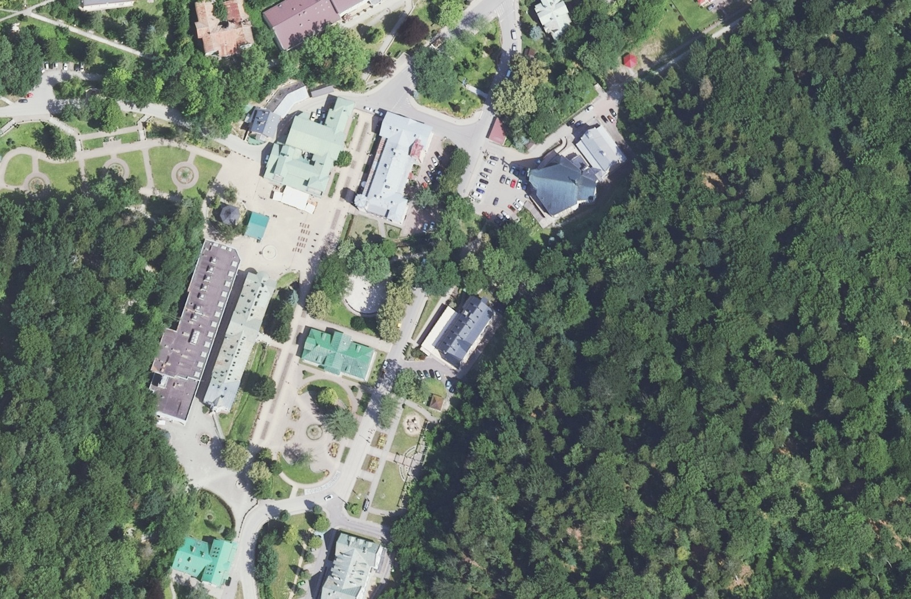

# Zdjęcia referencyjne Iwonicza-Zdroju

Sprawdzono 31 października 2026 r. Cel: dokładniejsze budynki i teren w istniejącej mapie izometrycznej.

## Wybrane źródło

**GUGiK / Państwowy Zasób Geodezyjny i Kartograficzny — ortofotomapa lotnicza.**

- [Oficjalny opis, rozdzielczości, przeglądanie i zasady pobierania](https://www.geoportal.gov.pl/pl/dane/ortofotomapa-orto/).
- [WMS wysokiej rozdzielczości](https://mapy.geoportal.gov.pl/wss/service/PZGIK/ORTO/WMS/HighResolution?SERVICE=WMS&REQUEST=GetCapabilities).
- [Skorowidz według aktualności](https://mapy.geoportal.gov.pl/wss/service/PZGIK/ORTO/WMS/SkorowidzeWgAktualnosci?SERVICE=WMS&REQUEST=GetCapabilities).

W oficjalnym opisie ortofotomapa jest wskazana jako bezpłatna do pobrania i możliwa do dowolnego wykorzystania. Usługa WMS odsyła dodatkowo do regulaminu Geoportalu. Atrybucję GUGiK/PZGiK zachowano w metadanych opracowania.

## Potwierdzone metadane dla punktu w centrum

Zapytanie `GetFeatureInfo`, WMS 1.3.0, `CRS:84`, bbox `21.7865,49.5605,21.7925,49.5645`, obraz 1000×1000, piksel I=450, J=550. Metadane są potwierdzone dla tego miejsca, nie dla każdego arkusza w całym mieście.

| Zestaw | Aktualność zdjęć | Piksel terenowy | Zastosowanie |
| --- | --- | --- | --- |
| Orto RGB, arkusz M-34-92-B-c-1-4 | 2024-06-19 | 0,25 m | Nowszy punkt odniesienia: dachy, zagospodarowanie, drogi |
| Orto CIR, ten sam arkusz | 2024-06-19 | 0,25 m | Pomocnicze rozróżnianie roślinności, nie naturalne kolory dachów |
| Orto RGB, arkusz M-34-92-B-c-1-4-1 | 2017-04-02 | 0,07 m | Drobne detale, alejki i korony drzew w okresie bezlistnym; historyczna zabudowa |
| Orto RGB, arkusz M-34-92-B-c-1-4 | 2022-05-19 | 0,25 m | Porównanie zmian z 2024 r. |

Przy sprawdzeniu punktu nie zwrócono arkuszy z lat 2025/2026. Nie oznacza to braku takich materiałów dla całej gminy ani poza sprawdzoną usługą.

Pliki źródłowe:

- [RGB 2024, GeoTIFF ~57 MiB](https://opendata.geoportal.gov.pl/ortofotomapa/81421/81421_1364771_M-34-92-B-c-1-4.tif).
- [CIR 2024](https://opendata.geoportal.gov.pl/ortofotomapa/81420/81420_1360232_M-34-92-B-c-1-4.tif).
- [RGB 2017, 7 cm](https://opendata.geoportal.gov.pl/ortofotomapa/65912/65912_498531_M-34-92-B-c-1-4-1.tif).

## Analiza obrazu

Obejrzano rzeczywiste obrazy WMS centrum i jego zachodniego otoczenia. Warstwa HighResolution preferuje rozdzielczość przed aktualnością — zdjęcie ostrzejsze może być starsze. Nie należy jej nazywać „najnowszym zdjęciem”. Obrazy są zdjęciami lotniczymi, nie satelitarnymi.

Na próbce centrum widoczne są różne kolory pokryć: szare, zielonkawe i ceglaste. Długie budynki sanatoryjne różnią się geometrią od małych willi. Widoczne są też utwardzone place, parkingi, alejki oraz wyraźne skupiska zieleni. Jednolity kolor lub losowe barwy dachów w rendererze upraszczają te różnice. Drzewa i cienie zasłaniają część budynków oraz nawierzchni; próbki zdjęć nie wystarczają do pewnego ustalenia materiału dachu, liczby pięter czy wyglądu elewacji.

## Bezpieczny zakres ulepszeń mapy

1. Zachować współrzędne i obrysy OSM.
2. Pobierać przybliżone kolory dachów ze zdjęcia RGB o znanej dacie, tylko wewnątrz zasięgu arkusza. Oznaczać źródło i metodę; poza zasięgiem pozostawić stylizację.
3. Rysować place piesze, parkingi i fontanny tam, gdzie mają odpowiadające im geometrie OSM, zamiast zgadywać ich granice ze zdjęcia.
4. Dla dachów wykorzystywać `roof:shape` OSM, jeżeli jest dostępne. Nie odgadywać wysokości na podstawie cienia bez modelu wysokościowego i parametrów nalotu.
5. Nie dodawać fikcyjnych dróg ani pojedynczych drzew tylko na podstawie automatycznej segmentacji obrazu. Korekty geometrii wymagają osobnej weryfikacji.

Zasięg jednego arkusza nie pokrywa całego miasta. Analiza próbki centrum nie jest pełną inwentaryzacją terenu. Pomiary kolorów to przybliżenie podatne na cienie, roślinność, panele PV oraz przesunięcie obrysu OSM względem dachu na zdjęciu. Wysokości i elewacje nadal pozostają stylizowane.

## Wdrożone po analizie

Z oryginalnego arkusza RGB 2024 wyznaczono przybliżone kolory dla 62 obrysów budynków OSM wewnątrz zasięgu arkusza. Z tego 52 obiekty mają środek wewnątrz granicy miasta i otrzymują kolor w rendererze. Pozostałe obrysy leżą w otaczającym bbox; renderer przycina mapę do granicy miasta. Próbki, data nalotu, metoda i SHA-256 pliku są w `data/ortho-observations.json`. Renderer korzysta z tych kolorów zamiast losowej palety tam, gdzie istnieje wiarygodna próbka. Pozostałe dachy pozostają stylizowane. Wysokości, materiały dachów i elewacje nie są wyznaczane ze zdjęcia.

Dodano również wypełnienia obszarów parkingowych i placów pieszych oraz symbole fontann na podstawie geometrii OSM. Nie zmieniano geometrii źródłowych ani sieci ruchu. Dokumentacja i obserwacje odnoszą się do jednego arkusza; pozostała część miasta wymaga kolejnych arkuszy, zanim można będzie przypisać jej podobne obserwacje.

Podgląd fragmentu oryginalnego GeoTIFF z 2024 r. (przycięty i zmniejszony, północ nieznacznie odchylona względem pionu w układzie PL-1992):

